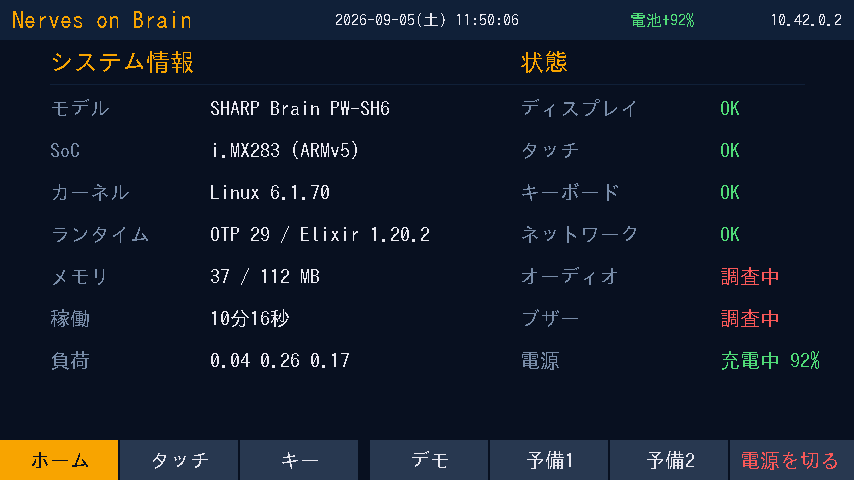
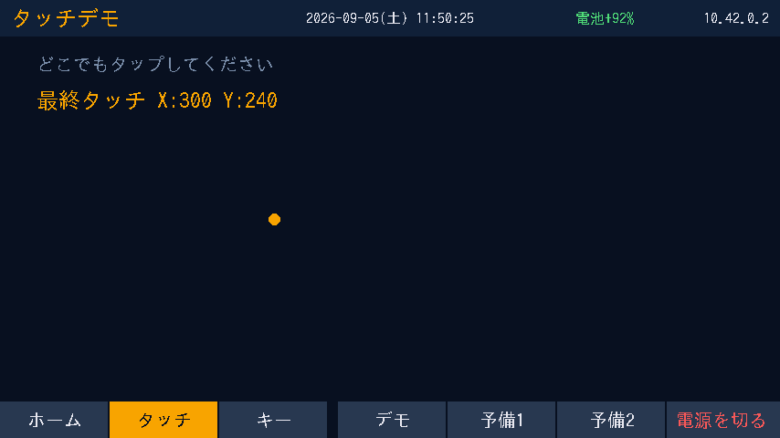
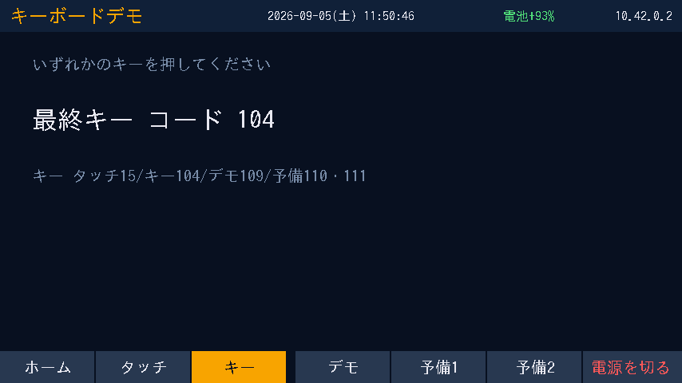
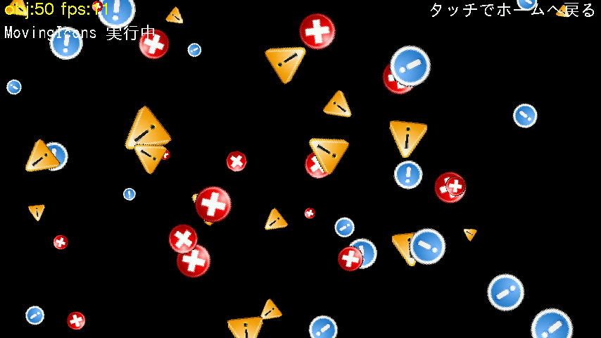

# hello_kiosk

SHARP Brain **PW-SH6** で `nerves_system_brain` を試すための Elixir/Nerves アプリケーション例。
Mix application / release 名は互換性のため `hello_kiosk_brain` を維持する。

> **2026-11-13: feature port 作業中（WIP）**
> `kurokouji/hello_kiosk_brain` の追加機能を取り込んだが、**この状態での host build・
> firmware build・PW-SH6 実機検証は未実施**。以下の「従来確認済み」は移植前の構成を指す。
> 現在の課題と受け入れ条件は [ロードマップ](docs/port-roadmap.md)、差分と制約は
> [移植記録](docs/feature-port-20261113.md) を参照。

## 何ができるか

| 領域 | 構成・機能 | 検証状況 |
|---|---|---|
| 描画と入力 | LovyanGFX、854×480 LCD、タッチ・ペン・キーボード | 旧 UI で実機確認済み。新 UI は未検証 |
| Kiosk | ホーム、タッチ/キー、デモ選択、BLE センサ、音声デモ、設定、電源メニュー | 機能移植済み・未検証 |
| デモ | MovingIcons、パパパの二重唱、フライト、花火、おしゃべり時計、世界時計、プラネタリウム、手書きメモ、ネットワークカメラ（計9カード） | デモの追加/統合は未検証。一部は別途音声素材が必要 |
| OS 連携 | 電池・5V状態、RTC、起動記録、永続メモ、音量とWi-Fi設定 | 機能移植済み・未検証 |
| 周辺機器 | USB オーディオ、録音、Bluetooth speaker、SwitchBot BLE scan | 対応機器とドライバでの確認待ち |
| 開発基盤 | NervesSSH、VintageNet、USB HOST/NCM、A/B `mix upload` | 移植前に実機確認済み。移植後の回帰確認待ち |

**移植済み ≠ 動作保証。** PW-SH6 の実機で動くか、追加ドライバやデータが必要かは
[ロードマップ](docs/port-roadmap.md) で個別に管理する。
充電制御は `enable_charger: false` により既定で起動しない。
バックライト調光と BU26154 内蔵音声は、現行 kernel/DTB では利用を前提にしない。

## 構成

```text
examples/hello_kiosk/
  config/                Nerves application の host / target 設定
  lib/hello_kiosk_brain/ UI、入力、デモ、機器連携
  priv/demo/             世界時計・星空データ（配布条件は NOTICE を参照）
  scripts/               母艦用補助ツールと素材生成スクリプト
  test/                  host で実行する既存テスト
  docs/                  移植記録、ロードマップ、ADR、worklog
```

責務の境界は以下のとおり。

- **System:** U-Boot/kernel/DTB、USB HOST/NCM の切替、Nerves firmware/A-B、永続領域の mount。
- **アプリ:** UI/描画、入力、音声/BLE/RTC、デモ、ユーザー設定。
- **標準パッケージ:** ネットワーク設定は VintageNet、SSH は NervesSSH、描画は
  [`lovyangfx_elixir`](https://github.com/piyopiyoex/lovyangfx_elixir)。

`HelloKioskBrain.UsbMode` は System の `/usr/bin/brain-usb-mode` を呼び出す。
`WifiConfig` は VintageNet に依頼し、`wpa_supplicant.conf` を直接書き換えない。
`CameraMonitor` に画面を渡している間、通常の Kiosk は framebuffer を上書きしない。

## 開発環境とビルド

System 初回構築と SD 起動は [初回セットアップガイド](../../docs/getting-started.md)、
A/B 更新は [mix upload](../../docs/mix-upload.md) を参照。
`.tool-versions` に指定した Erlang/Elixir を mise や asdf で準備する。

リポジトリルートで必要な System をビルドしてから、example ディレクトリで firmware を作る。

```sh
# repository root
mix brain.system.build

cd examples/hello_kiosk
export MIX_TARGET=brain
mix deps.get
mix firmware
```

テスト用の **空の microSD** に初期書き込みする場合のみ、内容が消えることを確認してから実行する。

```sh
mix burn
```

現行の A/B firmware layout を持つ microSD 上の application を更新する場合は、
SSH 経由の `mix upload` を使う（ネットワークと SSH が利用可能なとき）。

```sh
mix upload nerves.local
```

`mix burn` は p4 の永続データも再初期化する。`mix upload` は inactive rootfs のみを書き換え、
通常は `/data` を保持する。System boot asset を変更するときは別の検証用カードで
`mix burn` する。USB HOST/NCM は排他的なので、SSH で更新できる経路を事前に確認する。

host 側のテストは以下を入口とする（**この WIP patch に対して未実施**）。

```sh
cd examples/hello_kiosk
MIX_TARGET=host mix deps.get
LOVYANGFX_ELIXIR_SKIP_NATIVE=1 MIX_TARGET=host mix test
```

## 実機での注意点

- **時刻:** `/dev/rtc0` が使えない構成でも i.MX28 SoC 内の RTC register は存在する。
  System の `restore_brain_rtc` と、今回移植した `BrainClock` がそれぞれ時刻同期を行うため、
  競合や書き込み可否を実機で確認する。旧 `scripts/settime.sh` は以前の RTC 前提の補助ツールであり、
  現行の推奨手順としては扱わない。
- **Wi-Fi:** VintageNet が設定を管理する。IEx で `VintageNet.info()` を確認できる。
  設定画面の保存では再接続が起こるため、Wi-Fi 以外の復旧手段を用意して試す。
- **音声:** 主経路は USB audio の方針。音声素材と USB device は別途準備する。
  素材なしで動く画面と、素材が揃わないと利用できないデモを区別する。
- **バックライト:** `Backlight` API があっても現在の DTB で物理調光ができるとは限らない。
  既存 [ADR 0003](docs/adr/0003-バックライト制御線_調査結論.md) の判断は変更していない。
- **バッテリー:** 充電制御の PMU register 書き込みは安全性の検証まで無効のままとする。

## スクリーンショット

以下は**移植前の旧 4 画面 UI**の実機記録。新 UI の実行結果ではない。
新 UI の実機確認後に撮り直す（[ロードマップ P1](docs/port-roadmap.md)）。

| 旧ホーム | 旧タッチ |
|---|---|
|  |  |

| 旧キー | 旧デモ |
|---|---|
|  |  |

## ドキュメントの入口

- [移植ロードマップ](docs/port-roadmap.md): 次の作業、優先順位、完了条件、テスト記録の方法
- [移植機能・設計差分](docs/feature-port-20261113.md): 元アプリとの差分、維持した構成、配布素材
- [設計判断と実機知見](docs/README.md): ADR / worklog の入口
- [System 全体の構成](../../docs/README.md): Nerves System / application / boot assets の境界
- [デモ素材のクレジット](NOTICE.original-demos): 同梱データおよび未同梱素材の権利情報
